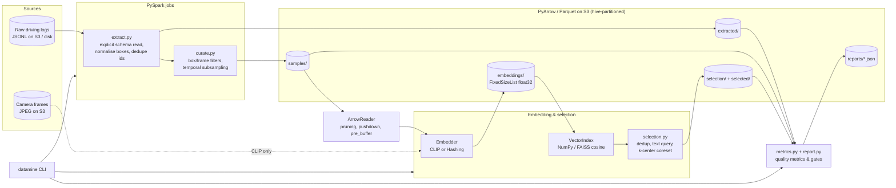

# DataMine: AV Perception Data Pipeline

DataMine is a data-centric curation pipeline for autonomous-vehicle perception datasets. It
takes large multi-camera driving logs and turns them into a clean, compact, diverse training
set:

1. **Extract** labelled samples from raw JSONL driving logs with **PySpark**. Ego pose, scene
   tags and 2D boxes are normalised into a typed schema.
2. **Curate** them. Degenerate, out-of-bounds, tiny and unknown-class boxes are dropped, along
   with frames missing their image. Frames are subsampled in time so idle-ego redundancy goes
   away.
3. **Embed** every sample with **CLIP** (`open_clip`) or a deterministic hashing embedder that
   needs no dependencies. Embedding runs either on the driver or on Spark executors through
   `mapInArrow`.
4. **Select** samples using **vector similarity**. Near-duplicates are removed, text queries
   such as *"a cyclist in heavy rain"* retrieve the scenarios you ask for, and a greedy
   **k-center coreset** spends the remaining budget on diversity.
5. **Measure dataset quality** at every stage: label completeness, box validity, class
   balance, duplicate rate, embedding diversity and coverage. Each metric has pass/fail gates.
6. **Store** everything as **PyArrow/Parquet** on **AWS S3** or local disk, partitioned by
   `log_id`/`camera`. `ArrowReader` serves fast filtered reads with partition pruning, predicate
   pushdown, column projection and S3 range pre-buffering.

## Architecture



### Project layout

```
src/datamine/
  config.py            YAML + env-driven PipelineConfig
  schema.py            Arrow schemas (samples, embeddings, selection) + Spark DDL
  storage.py           s3:// or local URIs -> pyarrow.fs; Parquet/JSON IO
  synth.py             synthetic multi-camera logs with injected defects
  spark/session.py     SparkSession factory (S3A via default AWS credential chain)
  spark/extract.py     raw JSONL -> canonical samples
  spark/curate.py      label/frame filters, temporal subsampling, partitioned writer
  embeddings/          Embedder ABC, HashingEmbedder, ClipEmbedder (open_clip)
  embedding_store.py   Parquet embedding store, Spark mapInArrow embedding
  vector_index.py      exact cosine top-k (NumPy, optional FAISS)
  selection.py         dedup, k-center greedy, text-query retrieval
  metrics.py           quality metrics on Arrow tables
  report.py            QualityReport, gates, selection coverage
  reader.py            ArrowReader for low-latency filtered access
  pipeline.py          end-to-end orchestration
  cli.py               `datamine` command
configs/default.yaml   default pipeline configuration
tests/                 pytest suite
```

## How to run

### Prerequisites

- Python 3.10+
- Java 11 or 17, which PySpark needs
- Optional: AWS credentials for S3, and a GPU for CLIP embedding at scale

```bash
python -m venv .venv && source .venv/bin/activate
pip install -e ".[dev]"            # core + tests
pip install -e ".[clip,faiss,s3]"  # optional: CLIP embeddings, FAISS index, boto3
cp .env.example .env               # edit as needed, then: set -a; source .env; set +a
```

### Local end-to-end run on synthetic data

```bash
datamine synth --out ./data/raw --logs 8 --frames 300
datamine -c configs/default.yaml run --raw ./data/raw --out ./data/curated --budget 500
datamine -c configs/default.yaml query "pedestrian crossing at night" -k 5 --out ./data/curated
```

`run` prints a quality summary for each stage, for example:

```
[extracted] samples=9600 passed=False
  FAIL box_validity: 0.9861 >= 0.98 ...
[curated] samples=... passed=True
```

Detailed JSON reports go to `<out>/reports/`.

### Individual stages

```bash
datamine extract --raw s3://my-bucket/raw-logs --out s3://my-bucket/datamine
datamine embed   --out s3://my-bucket/datamine --embedder clip       # driver / GPU
datamine embed   --out s3://my-bucket/datamine --distributed         # Spark executors
datamine select  --out s3://my-bucket/datamine --budget 10000
datamine report curated --out s3://my-bucket/datamine --with-embeddings --fail-on-gate
```

### Running on S3

- Credentials come from the standard AWS chain: environment variables, `~/.aws`, or an
  instance/IRSA role. Nothing is hard-coded.
- Spark uses `s3a://` via `hadoop-aws`, which `build_spark` adds when it detects AWS
  configuration. PyArrow uses `pyarrow.fs.S3FileSystem`.
- Set `DATAMINE_S3_ENDPOINT` to point at MinIO/LocalStack for local S3 testing.
- CLIP mode reads frames from each sample's `image_uri`, so the images must be reachable
  through the same credentials.

### Programmatic access

```python
from datamine.reader import ArrowReader

reader = ArrowReader("s3://my-bucket/datamine/selected")
night_peds = reader.scan(time_of_day=["night"], cameras=["front"], min_labels=3)
rows = reader.get(["log_00003:front:000120", "log_00001:rear:000042"])
```

## How to test

```bash
pip install -e ".[dev]"
pytest
```

- `tests/test_metrics.py`, `test_embeddings_and_selection.py`, `test_reader.py` and
  `test_synth_and_config.py` need only PyArrow and NumPy.
- `tests/test_spark_pipeline.py` runs Spark in `local[2]` mode and covers extraction,
  curation and the full pipeline. It **skips automatically** when PySpark or a Java runtime
  is missing.
- None of the tests need network access, S3 or CLIP weights. They use the synthetic log
  generator and the hashing embedder.

## Design notes

- **Embeddings without images.** `HashingEmbedder` maps scene semantics (classes, weather,
  time of day, crowding, coarse object positions) into a shared token space with seeded random
  projections. Text queries land near matching scenes, much as in CLIP's joint space, so the
  selection logic can be exercised and tested without GPUs or images.
- **Selection order matters.** Deduplication runs in timestamp order, so the first frame of a
  stationary run survives. Text-query hits are kept as must-haves, and k-center is seeded with
  them so the diversity budget covers what the queries missed.
- **Lossless extraction, strict curation.** Extraction keeps bad labels so that quality
  metrics can quantify them. Curation removes them, and the extracted vs. curated reports show
  the difference.
